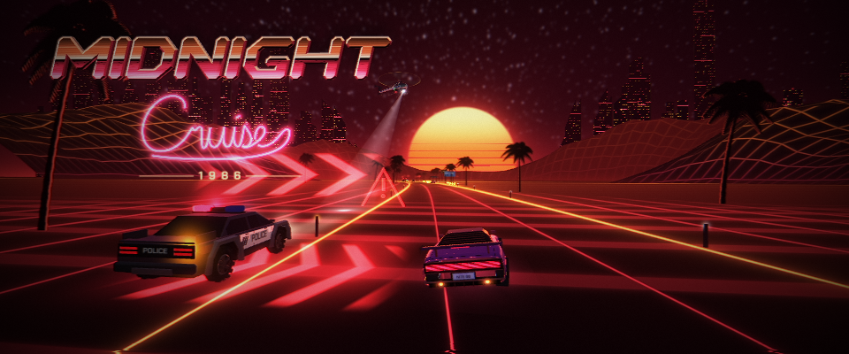
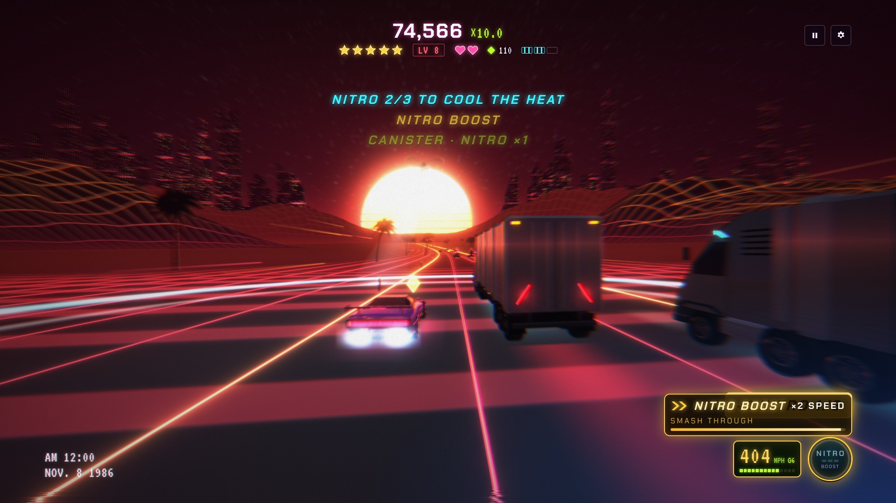

# MIDNIGHT CRUISE — 1986

**A midnight police chase through Neon City, set to an original synthwave soundtrack.**

**[Play free on itch.io](https://leo8654.itch.io/midnight-cruise)** · [Play on GitHub Pages](https://leo-zhang-source.github.io/midnight-cruise/) · [简体中文](README.zh-CN.md)

Single player · Plays in your browser · Keyboard, mouse or touch

It's just after midnight on the Neon City Beltway. You're driving the PHANTOM, traffic is still moving, and the patrol behind you has called for backup.

**Midnight Cruise — 1986** is an arcade driving game about finding a way through an increasingly crowded pursuit. Read the traffic, time your lane changes and keep the run going to beat your best score. The car accelerates automatically, so every decision is about where to go next.

## Through the traffic

Turn signals, brake lights and attack warnings give you a moment to react. A taxi may merge into your lane; a cruiser may try to box you in. As the pursuit builds towards five stars, interceptors, rolling roadblocks and AIR-7 join the chase. Staying ahead means watching more than the car directly in front of you.

## A way through the roadblock

Nitro gives you a brief burst towards double speed, enough to smash through vehicles, shake off the pursuit car and recover a lost life. You can carry up to three canisters. Using one early can help build your score; keeping one in reserve gives you an escape when the road closes in.

Start at **LV 0** while you learn the traffic and attack patterns, or choose a starting threat level up to **LV 20** for a faster, more demanding run.

## Rewind the last three seconds

After a wreck or capture, a spare VHS tape lets you return to the moment before it happened. The traffic runs backwards, then the chase resumes with another chance to change lane. Every run starts with one tape. Collect 100 energy cells to earn another, up to three in reserve.

## An eighties night drive

A cinematic opening, wireframe hills and a skyline lit in neon set the scene. Scanlines and tape distortion give the picture the texture of an old recording. The original synthwave score is synthesised live and changes as the pursuit intensifies, alongside the sound of shifting gears and approaching sirens.

Choose **Sunset, Blue Hour, Afterglow or Lagoon**, or let the palette change as you drive. Headphones recommended.

## Take the wheel

Click **Run game** on itch.io, then **START DRIVE**. The car handles acceleration; there is no brake.

| Action | Keyboard | Mouse / touch |
|---|---|---|
| Change lane | `←` / `→` or `A` / `D` | Click or tap the left / right half of the road |
| Fire nitro | `↑` (`W` or `T` also work) | **NITRO**, when you have a canister |
| Pause / resume | `P` | Pause / **RESUME** |
| Settings | `O` | Gear icon |
| Skip the opening | `S` | **SKIP INTRO** |
| Rewind after a wreck or capture | `R` | **REWIND 3 S**, with a spare tape |
| Mute / unmute | `M` | Sound control in Settings |

**Before your first run:**

- Start at **LV 0** to learn the traffic and attack warnings. The threat level rises every 20 seconds.
- You have **two lives**. A hit costs one; another hit before you recover ends the run. Nitro restores the lost life.
- Your best score is saved in the current browser when local storage is available. Scores do not sync between devices or between itch.io and GitHub Pages.
- Use a current browser with **WebGL 2** enabled. On a phone, landscape gives you more room to read the road. The game interface is in English; both English and Chinese introductions are available.

If the game is silent, click or tap inside it and check **Settings → volume**, the mute control and your browser tab's sound setting. For a direct browser window, use the [GitHub Pages version](https://leo-zhang-source.github.io/midnight-cruise/).

## Behind the chase

The world is rendered in real time with three.js and WebGL 2. The score, engines and effects are synthesised in the browser, with CC0 drum and cymbal samples. The gameplay simulation records a deterministic timeline, which also powers the rewind.

- [Gameplay & technical reference](REFERENCE.md) — complete controls, pursuit mechanics, local setup, testing and builds.
- [Press kit](press/README.md) — descriptions, cover art composed from an actual game scene, and gameplay screenshots.
- [Creative treatment & audio measurements](REPORT.md).
- [Credits & third-party licences](CREDITS.md).

Found an issue? [Report it on GitHub](https://github.com/leo-zhang-source/midnight-cruise/issues), including your browser, device and what happened.
