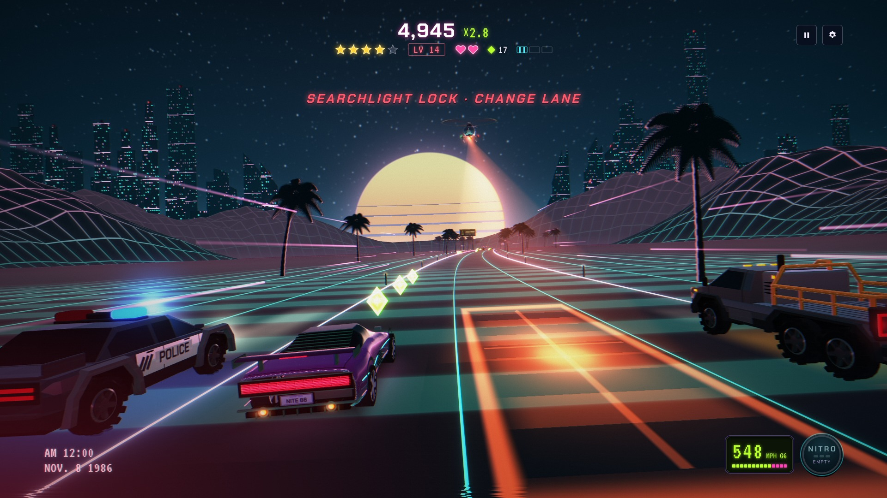

# MIDNIGHT CRUISE — 1986

### Three lanes. No brakes. One more chance.

**A synthwave arcade police chase. Thread the traffic, break through roadblocks with nitro, and rewind your last mistake.**

**[Play free on itch.io](https://leo8654.itch.io/midnight-cruise)** · [Play on GitHub Pages](https://leo-zhang-source.github.io/midnight-cruise/) · [简体中文](README.zh-CN.md)

Single player · Plays in your browser · Keyboard, mouse or touch

Midnight, November 8, 1986. The Neon City Beltway. The city glows ahead. Sirens close in behind. You're at the wheel of the PHANTOM, and lifting off isn't an option.

Read the gaps, slip past a line of brake lights, and get out of the searchlight before it turns red. Every clean overtake builds your combo. Every close call tempts you to push a little harder. Survive long enough, and a lone cruiser becomes a coordinated five-star pursuit.

## Make the next gap

The car accelerates automatically. You choose the lane and the moment to commit. Traffic merges, taxis cut across the road, and police cruisers turn an open lane into a moving trap. Watch the signals, anticipate the next move, and keep your way out in sight.

## Turn pursuit into a breakthrough

Collect nitro and turn a narrow escape into a charge through traffic. A burst drives you towards double speed, smashes vehicles out of your path, and restores a lost life. Spend a canister to build your score, or keep it for the moment the police close in. You can carry three.

The chase keeps escalating: rolling roadblocks, rear-wheel grapplers, interceptors on your flank, and AIR-7 overhead. At five stars, attacks combine and helicopter fire sweeps from lane to lane. Choose a starting threat level from **LV 0 to LV 20**; higher settings put you straight into a faster, more demanding run.

## The tape still has three seconds left

A wreck doesn't have to be the final frame. Spend a spare tape to rewind the last **three seconds**, watch the road and traffic run backwards, and take the gap you missed. Every run starts with one tape; collect 100 energy cells to earn another, up to three in reserve.

## A night caught on VHS

A 26-second cinematic opening drops you into the pursuit. Chrome, wireframe mountains and a shifting neon skyline sit beneath scanlines and tape distortion. The original synthwave score is synthesised live, adding urgency as the wanted level rises. Choose **Sunset, Blue Hour, Afterglow or Lagoon**, or let the colours change as you drive.

Turn the sound on. Headphones recommended.

## Take the wheel

Click **Run game** on itch.io, then **START DRIVE**. The car handles acceleration; there is no brake.

| Action | Keyboard | Mouse / touch |
|---|---|---|
| Change lane | `←` / `→` or `A` / `D` | Click or tap the left / right half of the road |
| Fire nitro | `↑` (`W` or `T` also work) | **NITRO**, when you have a canister |
| Pause / resume | `P` | Pause / **RESUME** |
| Settings | `O` | Gear icon |
| Skip the opening | `S` | **SKIP INTRO** |
| Rewind after a wreck or capture | `R` | **REWIND 3 S**, with a spare tape |
| Mute / unmute | `M` | Sound control in Settings |

**Before your first run:**

- Start at **LV 0** to learn the traffic and attack warnings. The threat level rises every 20 seconds.
- You have **two lives**. A hit costs one; another hit before you recover ends the run. Nitro restores the lost life.
- Your best score is saved in the current browser when local storage is available. Scores do not sync between devices or between itch.io and GitHub Pages.
- Use a current browser with **WebGL 2** enabled. On a phone, landscape gives you more room to read the road. The game interface is in English; both English and Chinese introductions are available.

If the game is silent, click or tap inside it and check **Settings → volume**, the mute control and your browser tab's sound setting. For a direct browser window, use the [GitHub Pages version](https://leo-zhang-source.github.io/midnight-cruise/).

## Behind the chase

The world is rendered in real time with three.js and WebGL 2. The score, engines and effects are synthesised in the browser, with CC0 drum and cymbal samples. The gameplay simulation records a deterministic timeline, which also powers the rewind.

- [Gameplay & technical reference](REFERENCE.md) — complete controls, pursuit mechanics, local setup, testing and builds.
- [Press kit](press/README.md) — approved descriptions, cover art and screenshots captured from the game.
- [Creative treatment & audio measurements](REPORT.md).
- [Credits & third-party licences](CREDITS.md).

Found an issue? [Report it on GitHub](https://github.com/leo-zhang-source/midnight-cruise/issues), including your browser, device and what happened.
