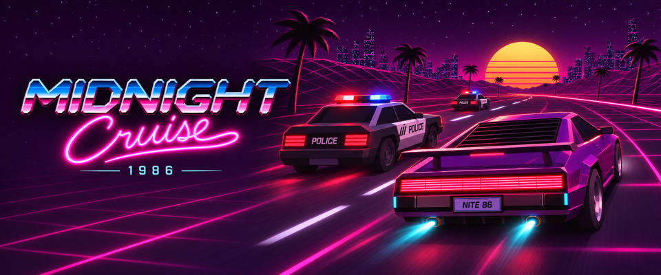
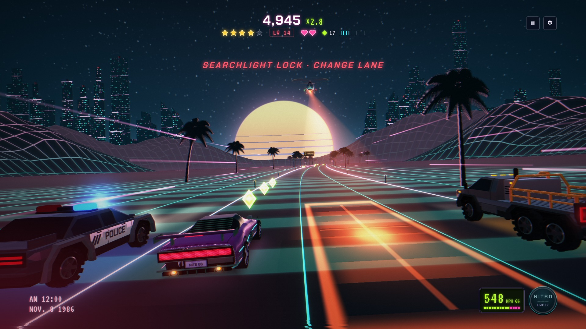
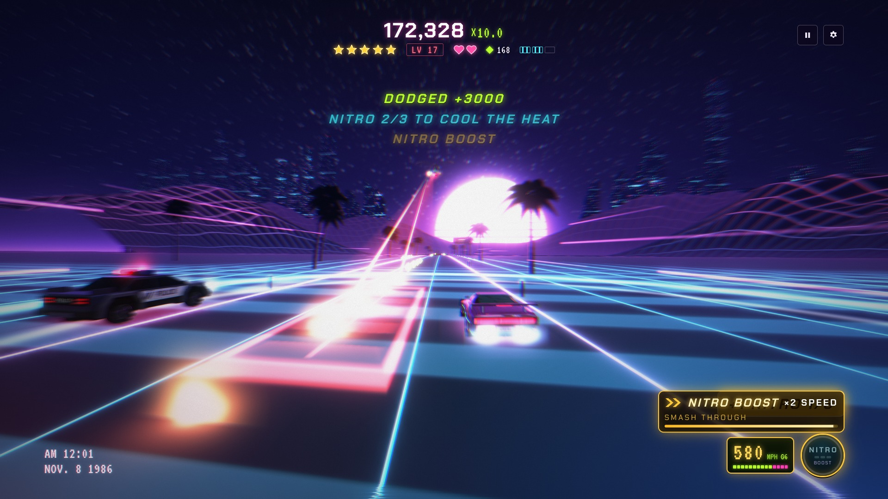

# MIDNIGHT CRUISE — 1986

### 三条车道，没有刹车。把最后三秒，再跑一次。

**一场披着合成器浪潮与 VHS 质感的街机追逐。穿过车流，用氮气撞开封锁，把失误倒回还有机会的那一刻。**

**[在 itch.io 免费游玩](https://leo8654.itch.io/midnight-cruise)** · [GitHub Pages 直达](https://leo-zhang-source.github.io/midnight-cruise/) · [English](README.md)

单人游戏 · 浏览器即开即玩 · 支持键盘、鼠标和触屏

1986 年 11 月 8 日，午夜。霓虹城环城公路。

前方是发光的天际线，身后是越来越近的警笛。你驾驶着 PHANTOM 飞驰，而这辆车，没有刹车。

在刹车灯之间找出空隙，赶在探照灯变红前换道，让一次次干净的超车连成更高的分数。擦身而过的距离越小，下一次冒险就越诱人。坚持得越久，追捕越凶：起初只有一辆警车，随后整条公路都加入围堵。

## 看准空隙，再切进去

车辆自动加速，你负责判断车道与时机。出租车突然并线，货车挡住视野，警车把刚刚空出的车道变成移动路障。留意转向灯和攻击预警，提前读懂下一步，才能在封锁合拢前穿过去。

## 留一罐氮气，还是现在突围？

拾取氮气，向双倍速度冲刺，撞开沿途车辆与警车；如果已经受伤，这次爆发还会恢复失去的一条生命。用它冲分，还是留作脱险的后手，由你决定。最多可携带三罐。

追捕会逐步升级至五星：滚动路障、后轮抓捕装置、侧翼拦截车，以及头顶的 AIR-7。高星级下，地面与空中的攻势会交错而来。起始难度可从 **LV 0 调至 LV 20**，既能从头熟悉节奏，也能直接投入高速追逐。

## 失手了，让磁带倒转

撞毁或被捕后，消耗一盘备用磁带，倒回最后 **三秒**。车流逆行，公路回卷，你重新握住刚刚错过的机会。

每局自带一盘磁带；每收集 100 个能量单元，再获得一盘，最多储存三盘。重来的机会有限，下一次换道仍要由你完成。

## 把整个夜晚录进 VHS

26 秒电影式开场将你带入追逐。镀铬、线框山脉、霓虹天际线，叠上扫描线与录像带失真；实时合成的原创配乐随着通缉等级升高而加紧节奏。Sunset、Blue Hour、Afterglow、Lagoon 四种色调可手动切换，也可让夜色一路流转。

打开声音。戴上耳机，听清引擎升挡与警笛逼近。

## 开始驾驶

在 itch.io 点击 **Run game**，再点击 **START DRIVE**。车辆自动加速，无需踩油门，也没有刹车。

| 操作 | 键盘 | 鼠标 / 触屏 |
|---|---|---|
| 左右换道 | `←` / `→` 或 `A` / `D` | 点击道路左半边 / 右半边 |
| 使用氮气 | `↑`（也支持 `W`、`T`） | 有库存时点击 **NITRO** |
| 暂停 / 继续 | `P` | 暂停按钮 / **RESUME** |
| 设置 | `O` | 齿轮图标 |
| 跳过开场 | `S` | **SKIP INTRO** |
| 结束后倒带 | `R` | 有备用磁带时点击 **REWIND 3 S** |
| 静音 / 恢复声音 | `M` | 设置中的声音按钮 |

初次游玩建议从 **LV 0** 开始，威胁等级每 20 秒上升一级。每局有两条生命：受到一次撞击或攻击失去一条，恢复前再次受击便会结束；氮气可以恢复失去的生命。

使用支持 **WebGL 2** 的现代浏览器。手机横屏更方便观察道路。**游戏界面为英文**；本页提供中文介绍与操作说明。最高分在浏览器允许本地存储时保存，不跨设备同步，itch.io 与 GitHub Pages 的记录也各自独立。

没有声音时，先点击游戏画面，再检查设置中的音量、静音按钮与浏览器标签页声音。也可通过 [GitHub Pages](https://leo-zhang-source.github.io/midnight-cruise/) 在独立浏览器页面打开。

## 进一步了解

- [玩法与技术参考（英文）](REFERENCE.md)：完整规则、追捕机制、开发和构建说明。
- [宣传素材包](press/README.md)：正式文案、封面与实机截图。
- [创作说明与音频测量](REPORT.md)。
- [素材署名与第三方许可](CREDITS.md)。

遇到问题，可在 [GitHub Issues](https://github.com/leo-zhang-source/midnight-cruise/issues) 留下浏览器、设备和复现步骤。
